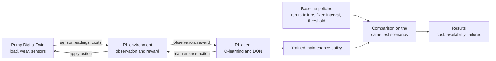
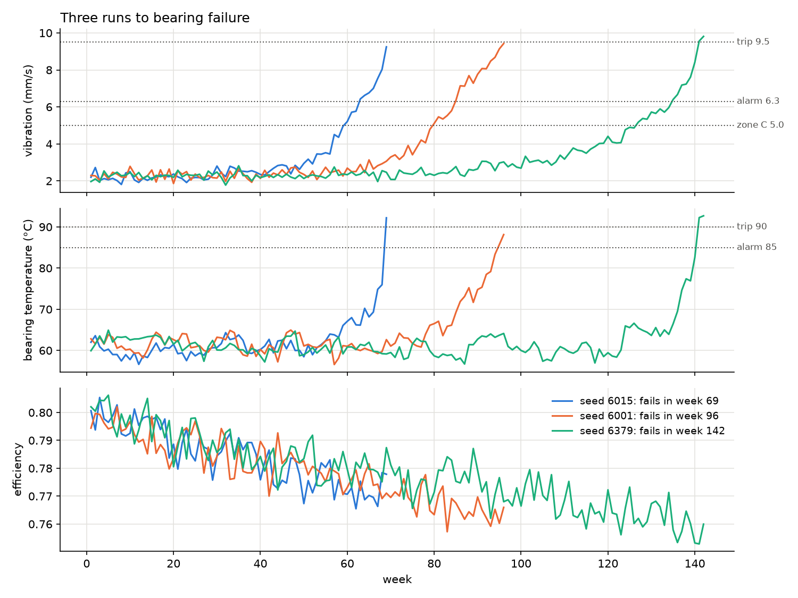

# Predictive Maintenance of a Pump with a Digital Twin and Reinforcement Learning

Course project for **Work Systems Design** (IIT Kharagpur, Autumn 2026-27).

A centrifugal pump in a thermal power plant wears out as it runs. This project builds a **Digital Twin** of the pump in Python: a simulation that wears out over time, gives noisy sensor readings and responds to maintenance actions. A **Reinforcement Learning agent** interacts with the twin and learns when to keep running, when to do minor maintenance and when to do a major overhaul. The agent is compared with the classic maintenance strategies (run to failure, fixed interval and condition based) on the same simulated scenarios.

## Project status

| Phase | Topic | Status |
|---|---|---|
| 0 | Problem statement and repository setup | Done |
| 1 | Domain study and data source decision | Done |
| 2 | Digital Twin | Done |
| 3 | Twin verification, calibration and EDA | Done |
| 4 | RL formulation and environment | Done (cost values under review) |
| 5 | Baselines and evaluation harness | Not started |
| 6 | Tabular Q-learning with value iteration check | Not started |
| 7 | DQN agent in PyTorch | Not started |
| 8 | Maintenance decision support | Not started |
| 9 | Final evaluation | Not started |
| 10 | Final documentation | Not started |

## Workflow

This diagram shows the **planned** design. It will be updated as each phase is built and tested.



## Repository structure (current)

```
.
├── README.md
├── requirements.txt          pinned library versions
├── pytest.ini                test settings
├── src/
│   ├── config.py             paths, seed ranges and all Digital Twin constants
│   ├── pump_twin.py          the pump Digital Twin (load, wear, sensors, maintenance)
│   ├── twin_sim.py           runs the twin to failure and measures lifetimes and warning times
│   └── pump_env.py           Gymnasium environment: observation, actions, reward
├── scripts/
│   ├── calibrate_twin.py     chooses the twin constants against written targets
│   ├── simulate_twin.py      writes the run to failure data used by the EDA notebook
│   └── check_env.py          worked example and simple policies on the environment
├── notebooks/
│   └── 02_twin_eda.ipynb     checks of the twin and preprocessing decisions
├── results/
│   ├── figures/              figures saved by the notebook
│   └── tables/               calibration grid, target check, smoothing comparison
└── tests/
    ├── test_setup.py         checks that the environment works
    ├── test_twin.py          checks the Digital Twin
    ├── test_twin_sim.py      checks the simulation tools and the calibration targets
    └── test_env.py           checks the RL environment and its rewards
```

`data/` is created by `scripts/simulate_twin.py` and is not stored in the repository. More folders (`models/`) are added in the phases that need them.

## The Digital Twin

The twin simulates one motor driven boiler feed pump in a coal fired power plant, one week per step.

- **Load:** weekly unit load (60%, 75% or 90% of rated flow) changes as a Markov chain.
- **Hidden wear:** bearing wear grows faster as the bearing gets worse; impeller and wear ring wear grows steadily. Both grow with load². The shapes follow the NASA centrifugal pump prognostics model.
- **Sensors:** vibration (mm/s RMS), bearing temperature (°C) and efficiency, each with noise. Vibration warns first and temperature rises only near the end, as in practice.
- **Maintenance:** minor maintenance renews the bearing; a major overhaul renews bearing and impeller; a failed pump must be repaired.
- **Limits:** vibration zones from ISO 10816-7 (Category I, above 200 kW) and bearing temperature limits from a power plant pump specification.

## Checking the twin

The wear and sensor constants were not guessed. `scripts/calibrate_twin.py` tests 60 combinations on one set of random seeds and keeps the one that meets every written target, using a fixed order of preference. The result is then checked on 500 fresh seeds that the calibration never used:

| Target | Measured on fresh seeds |
|---|---|
| Mean bearing life 90 to 120 weeks | 102.9 weeks |
| Mean impeller life 200 to 260 weeks | 232.7 weeks |
| Vibration in ISO zone C at least 4 weeks before a bearing failure, in at least 90% of runs | 99.6% |
| Median lead of the vibration alarm (6.3 mm/s): 4 to 8 weeks | 6 weeks |
| Median lead of the temperature alarm (85 °C): 1 to 3 weeks | 1 week |
| Temperature rises only after vibration enters zone C, in at least 90% of runs | 99.6% |
| Mean temperature at failure 88 to 98 °C (trip at 90 °C) | 91.1 °C |



The EDA notebook also decides how the readings are prepared for the agent. Load changes the healthy temperature by 4.5 °C, so vibration and temperature are used as the excess over a new pump at the same load. They are not smoothed, because near failure the signal climbs faster than the noise and any moving average adds delay. Efficiency changes slowly, so it is averaged over 8 weeks.

## The RL environment

`src/pump_env.py` wraps the twin as a Gymnasium environment. Each step is one maintenance decision.

- **Observation (6 numbers):** excess vibration and excess temperature over a new pump at the same load, an impeller wear estimate from the 8 week average efficiency, the load, and the running weeks since the bearing and the impeller were renewed. The true wear stays hidden, so the problem is only partly observable.
- **Actions:** 0 continue, 1 minor maintenance (new bearing, 3 days), 2 major overhaul (new bearing and impeller, 2 weeks).
- **Reward:** minus the total cost of the step: extra energy from a worn impeller, maintenance, failure repair and downtime. One cost unit is one week of the pump's full load energy (about ₹23.5 lakh).
- **Time:** a step that includes downtime lasts more than one week and is discounted by γ per week (γ = 0.99). A failure does not end the episode: the pump is repaired. Episodes last 10 years and end by time limit.

| Event | Cost with downtime (units) |
|---|---|
| Minor maintenance | 0.71 |
| Major overhaul | 3.5 |
| Bearing failure | 7.5 |
| Impeller end of life | 5.0 |

On 50 validation seeds, running to failure costs 38.5 ± 1.3 units per 10 years. The best simple fixed maintenance intervals cost about 25 to 27, so planned maintenance pays off and there is something for a smarter policy to learn.

## Setup

Requires Python 3.12. The virtual environment is kept outside the project folder.

```bash
python3 -m venv ~/venvs/pump-rl
source ~/venvs/pump-rl/bin/activate
python -m pip install --upgrade pip
cd path/to/this/repository
pip install -r requirements.txt
python -m pytest
```

All tests should pass (about a minute). Tested on macOS (Apple silicon, Python 3.12.2) and Linux (Python 3.12.3).

## Running the checks

Run these from the repository root:

```bash
python -m scripts.calibrate_twin      # about 4 minutes; writes results/tables/twin_calibration_*.csv
python -m scripts.simulate_twin       # about 1.5 minutes; writes data/twin_runs.csv and data/twin_lives.csv
jupyter notebook notebooks/02_twin_eda.ipynb
python -m scripts.check_env           # about 20 seconds; worked example and simple policies
```

The calibration script does not change `src/config.py`. It prints the chosen constants, which are copied into `config.PUMP` by hand. Every run uses fixed seeds, so the results are the same each time.

## Author

Nishank Chandoliya, IIT Kharagpur
