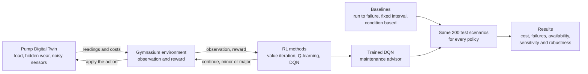
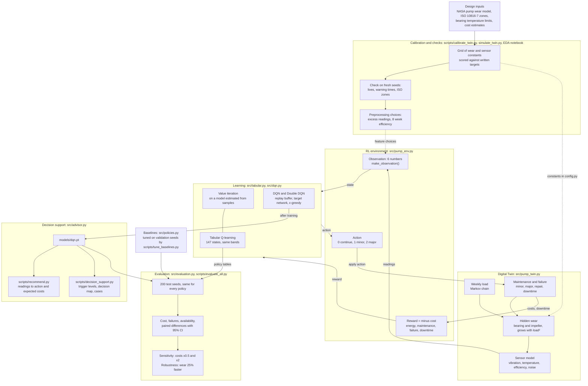
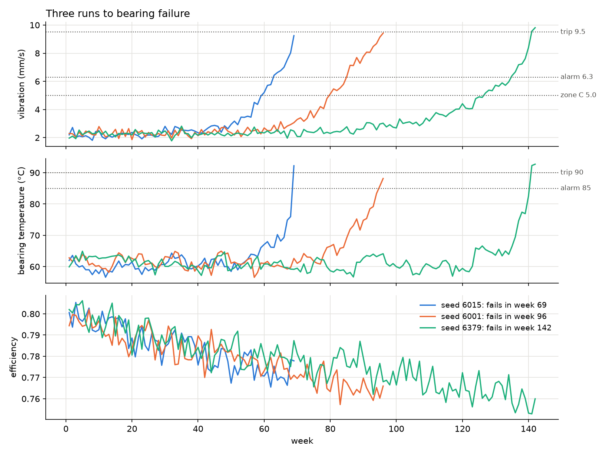
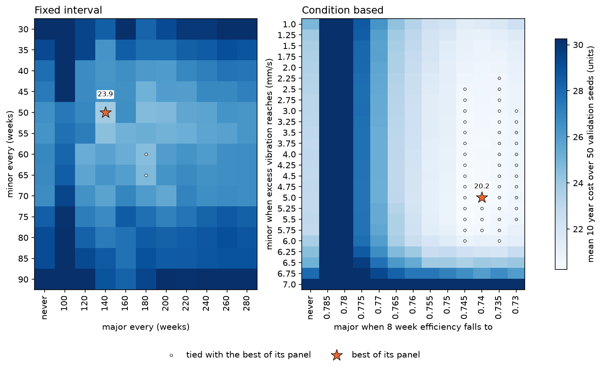
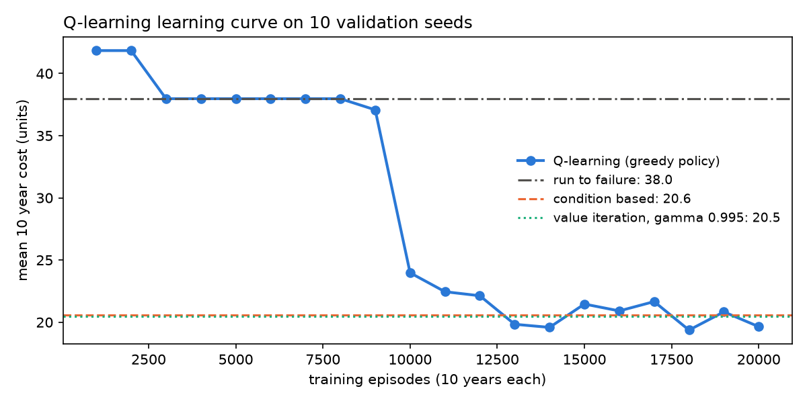
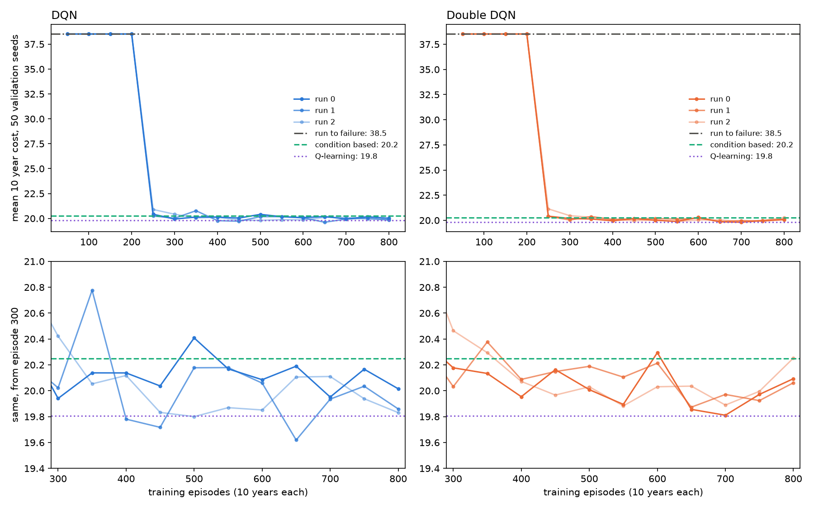
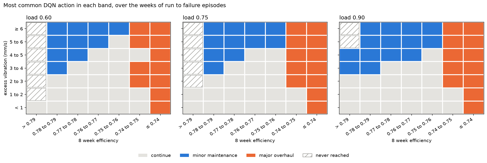
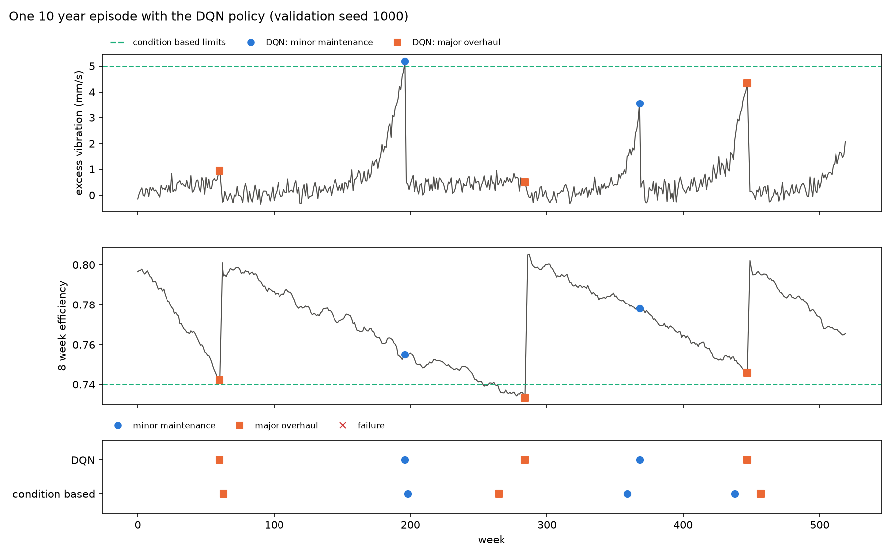
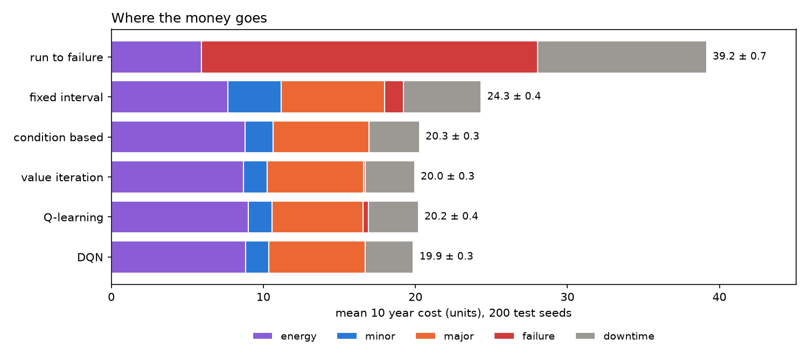
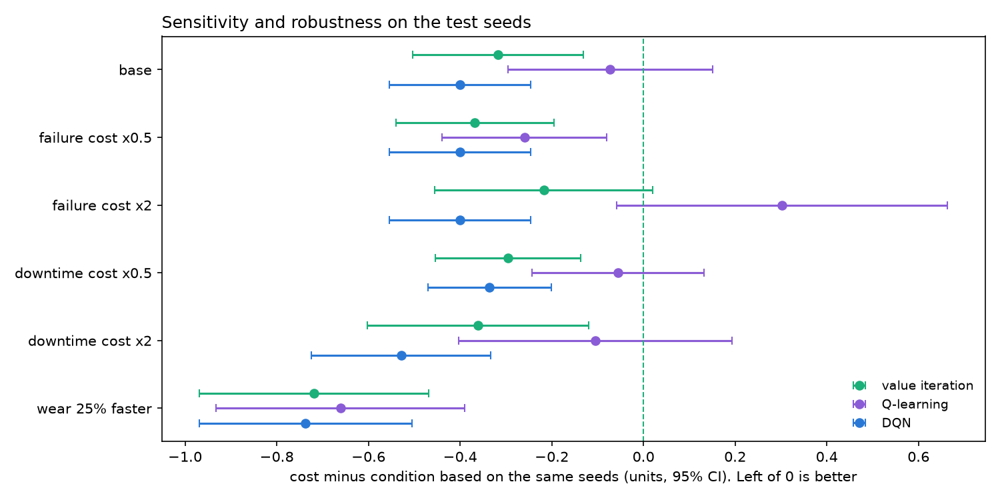

# Predictive Maintenance of a Pump with a Digital Twin and Reinforcement Learning

Course project for **Work Systems Design** (IIT Kharagpur, Autumn 2026-27)

A centrifugal pump in a thermal power plant wears out as it runs. This project builds a **Digital Twin** of the pump in Python: a simulation that wears out over time, gives noisy sensor readings and responds to maintenance actions. **Reinforcement Learning agents** interact with the twin and learn when to keep running, when to do minor maintenance and when to do a major overhaul. They are compared with the classic maintenance strategies (run to failure, fixed interval and condition based) on the same simulated scenarios

**Main result.** On 200 test scenarios that were never used for tuning, the DQN agent costs 19.9 units per 10 years (1 unit is about ₹23.5 lakh), against 20.3 for the best tuned rule (condition based maintenance), 24.3 for fixed interval maintenance and 39.2 for running to failure. The gain over the tuned rule is small, 0.40 ± 0.15 units or about 2%, but it is clear on paired scenarios and it holds in every sensitivity and robustness check. The agent learned this policy from the rewards alone, with no rule given to it

## Workflow



<details>
<summary>Detailed technical workflow</summary>



The loop readings → observation → agent → action → maintenance → wear → readings is how the agent and the twin interact. Dotted lines are offline steps

</details>

## Repository structure

```
.
├── README.md
├── requirements.txt          pinned library versions
├── pytest.ini                test settings
├── src/
│   ├── config.py             paths, seed ranges, Digital Twin constants, costs and baseline settings
│   ├── pump_twin.py          the pump Digital Twin (load, wear, sensors, maintenance)
│   ├── twin_sim.py           runs the twin to failure and measures lifetimes and warning times
│   ├── pump_env.py           Gymnasium environment: observation, actions, reward
│   ├── policies.py           baseline maintenance policies
│   ├── evaluation.py         runs any policy over seeds and computes the metrics
│   ├── tabular.py            discrete state, model estimate, value iteration and Q-learning
│   ├── dqn.py                Q-network, replay buffer, DQN and Double DQN training
│   └── advisor.py            turns plant readings into a recommended action with its expected cost
├── scripts/
│   ├── calibrate_twin.py     chooses the twin constants against written targets
│   ├── simulate_twin.py      writes the run to failure data used by the EDA notebook
│   ├── check_env.py          worked example and simple policies on the environment
│   ├── tune_baselines.py     grid search of the baseline settings on the validation seeds
│   ├── train_tabular.py      value iteration and Q-learning on the twin, with their results
│   ├── train_dqn.py          trains DQN and Double DQN (3 runs each) and scores them
│   ├── recommend.py          maintenance advisor for one set of readings (command line)
│   ├── decision_support.py   shows when and why the agent maintains: example run, trigger levels, decision map
│   └── evaluate_all.py       final comparison on the test seeds, sensitivity and robustness
├── notebooks/
│   └── 02_twin_eda.ipynb     checks of the twin and preprocessing decisions
├── models/
│   ├── tabular_vi.npz        value iteration values and policy table
│   ├── tabular_q.npz         Q-learning table and visit counts
│   ├── dqn_run*.pt           the 6 trained networks (DQN and Double DQN, 3 runs each)
│   └── dqn.pt                the network used for decisions (lowest validation cost)
├── results/
│   ├── figures/              figures saved by the notebook and the scripts
│   └── tables/               every number quoted in this README
└── tests/
    ├── test_setup.py         checks the environment and that only the final evaluation uses the test seeds
    ├── test_twin.py          checks the Digital Twin
    ├── test_twin_sim.py      checks the simulation tools and the calibration targets
    ├── test_env.py           checks the RL environment and its rewards
    ├── test_policies.py      checks the baseline rules
    ├── test_evaluation.py    checks the metrics on hand made episodes
    ├── test_tabular.py       checks value iteration and Q-learning on tiny MDPs with known answers
    ├── test_dqn.py           checks the DQN parts by hand and on a tiny MDP with a known answer
    └── test_advisor.py       checks the advisor and that its advice is sensible in clear cases
```

`data/` is created by `scripts/simulate_twin.py` and is not stored in the repository

## The Digital Twin

No public dataset has run to failure histories of a power plant pump together with the maintenance actions taken. An RL agent also has to try actions and see what happens, which a fixed dataset cannot offer. So the twin is built from published models and limits. It simulates one motor driven boiler feed pump in a coal fired power plant, one week per step

- **Load:** weekly unit load (60%, 75% or 90% of rated flow) changes as a Markov chain
- **Hidden wear:** bearing wear grows faster as the bearing gets worse; impeller and wear ring wear grows steadily. Both grow with load². The shapes follow the NASA centrifugal pump prognostics model. Every new part has its own random quality, so two bearings do not last equally long
- **Sensors:** vibration (mm/s RMS), bearing temperature (°C) and efficiency, each with noise. Vibration warns first and temperature rises only near the end, as in practice
- **Maintenance:** minor maintenance renews the bearing; a major overhaul renews bearing and impeller; a failed pump must be repaired
- **Limits:** vibration zones from ISO 10816-7 (Category I, above 200 kW) and bearing temperature limits from a power plant pump specification

Each seed fixes all the randomness of a 10 year scenario (load path, noise, part quality). Every policy therefore meets exactly the same pump history, which makes paired comparisons possible

## Checking the twin

The wear and sensor constants were not guessed. `scripts/calibrate_twin.py` tests 60 combinations on one set of random seeds and keeps the one that meets every written target, using a fixed order of preference. The result is then checked on 500 fresh seeds that the calibration never used:

| Target | Measured on fresh seeds |
|---|---|
| Mean bearing life 90 to 120 weeks | 102.9 weeks |
| Mean impeller life 200 to 260 weeks | 232.7 weeks |
| Vibration in ISO zone C at least 4 weeks before a bearing failure, in at least 90% of runs | 99.6% |
| Median lead of the vibration alarm (6.3 mm/s): 4 to 8 weeks | 6 weeks |
| Median lead of the temperature alarm (85 °C): 1 to 3 weeks | 1 week |
| Temperature rises only after vibration enters zone C, in at least 90% of runs | 99.6% |
| Mean temperature at failure 88 to 98 °C (trip at 90 °C) | 91.1 °C |



The EDA notebook also decides how the readings are prepared for the agent. Load changes the healthy temperature by 4.5 °C, so vibration and temperature are used as the excess over a new pump at the same load. They are not smoothed, because near failure the signal climbs faster than the noise and any moving average adds delay. Efficiency changes slowly, so it is averaged over 8 weeks

## The RL environment

`src/pump_env.py` wraps the twin as a Gymnasium environment. Each step is one maintenance decision

- **Observation (6 numbers):** excess vibration and excess temperature over a new pump at the same load, an impeller wear estimate from the 8 week average efficiency, the load and the running weeks since the bearing and the impeller were renewed. The true wear stays hidden, so the problem is only partly observable
- **Actions:** 0 continue, 1 minor maintenance (new bearing, 3 days), 2 major overhaul (new bearing and impeller, 2 weeks)
- **Reward:** minus the total cost of the step: extra energy from a worn impeller, maintenance, failure repair and downtime. One cost unit is one week of the pump's full load energy (about ₹23.5 lakh)
- **Time:** a step that includes downtime lasts more than one week and is discounted by γ per week (γ = 0.995). A failure does not end the episode: the pump is repaired. Episodes last 10 years and end by time limit

| Event | Cost with downtime (units) |
|---|---|
| Minor maintenance | 0.71 |
| Major overhaul | 3.5 |
| Bearing failure | 7.5 |
| Impeller end of life | 5.0 |

## Seeds

All tuning and model choices use 50 **validation** seeds (1000 to 1049). The 200 **test** seeds (2000 to 2199) are used once, by `scripts/evaluate_all.py`, after every policy was frozen; a test checks that no other code uses them. Training episodes use seeds from 10000 upwards and the twin calibration and EDA have their own seeds

## Baselines

Three classic strategies from the course Predictive Maintenance deck. Each one sees the same observation as the RL agent and was tuned by grid search on the validation seeds

| Policy | Rule | Mean 10 year cost, validation (units, 95% CI) |
|---|---|---|
| Run to failure | never maintain; repair after a failure | 38.5 ± 1.3 |
| Fixed interval | minor every 50 running weeks of the bearing, major every 140 of the impeller | 23.9 ± 0.7 |
| Condition based | minor when vibration is 5.0 mm/s above a new pump, major when the 8 week efficiency falls to 0.74 | 20.2 ± 0.6 |



The condition based surface is flat: vibration limits from about 2.25 to 6.0 mm/s are statistically tied with the best. Above about 5.75 mm/s failures start and the cost rises quickly

## Tabular RL check

Before the neural network agent, two table based methods from the course check that the environment and the reward make sense. The observation is cut into 147 states: excess vibration in bands of 1 mm/s, the 8 week efficiency in bands of 0.01 and the load level

- **Value iteration:** a transition model is estimated from 2.56 million simulated weeks and solved with the Bellman optimality equation
- **Q-learning:** learns directly from 20,000 simulated 10 year episodes with ε-greedy exploration

| Policy (50 validation seeds) | Mean 10 year cost (units, 95% CI) | Against condition based (paired) |
|---|---|---|
| Condition based (best baseline) | 20.2 ± 0.6 | reference |
| Value iteration, γ 0.99 | 21.4 ± 0.7 | +1.1 ± 0.6 |
| Value iteration, γ 0.995 | 20.1 ± 0.7 | −0.1 ± 0.3 |
| Q-learning, γ 0.995 | 19.8 ± 0.6 | −0.4 ± 0.3 |

With γ = 0.99 value iteration lets impellers wear out, because it values the long term energy saving of an overhaul too little, so the project uses γ = 0.995. The two policies agree in 97% of the often visited states, so the environment and the reward behave as intended



## DQN agent

`src/dqn.py` is our own DQN in PyTorch, written after the course pseudocode. The network gets the 6 observation numbers directly, without bands

- **Q-network:** 6 inputs, two hidden layers of 64 ReLU units, 3 outputs (one Q value per action)
- **Replay buffer:** the last 200,000 steps; each update uses a random batch of 64
- **Target network:** a copy of the Q-network, refreshed every 500 steps. The target is r + γ^weeks · max Q_target(s′), so a step with downtime is discounted for every week it lasts
- **Loss and optimiser:** Huber loss, Adam with a learning rate falling from 5e-4 to 5e-5
- **Exploration:** ε falls from 1.0 to 0.02 over the first 100,000 steps (about 190 episodes)
- **Double DQN:** a switch that lets the Q-network pick the next action and the target network value it

DQN and Double DQN were trained 3 times each (agent seeds 0, 1 and 2) for 800 episodes. Each run keeps its last network

| Policy (50 validation seeds) | Mean 10 year cost (units, 95% CI) | Against condition based (paired) |
|---|---|---|
| Condition based (best baseline) | 20.2 ± 0.6 | reference |
| Q-learning | 19.8 ± 0.6 | −0.4 ± 0.3 |
| DQN, runs 0, 1, 2 | 20.0, 19.9, 19.8 (± 0.6) | −0.2 ± 0.4, −0.4 ± 0.4, −0.4 ± 0.3 |
| Double DQN, runs 0, 1, 2 | 20.1, 20.1, 20.3 (± 0.6 to 0.8) | −0.2 ± 0.4, −0.2 ± 0.4, 0.0 ± 0.6 |



What the runs show:

- **It learns fast once ε is small.** While ε is high the random actions keep the pump new, so up to episode 200 every run behaves like run to failure. By episode 250 all runs are close to 20 units. Tabular Q-learning needed about 20,000 episodes for the same level, because a table cannot share what it learns between states
- **Double DQN gives no gain here.** For each network the predicted value of a new pump was compared with the discounted cost really seen when its policy runs: both variants are too optimistic by only about 5%
- **Two settings were needed for stable results.** With a constant learning rate the network kept changing after episode 650 and forgot about failures once the old failure examples left the buffer, so the learning rate now falls. With the target network copied every 2,000 steps the policy was good but the predicted costs were less than half the real ones, because a discount of 0.995 needs many more rounds of updates to settle

`models/dqn.pt` is DQN run 2, the run with the lowest validation cost

## Maintenance decision support

The trained network is used as a maintenance advisor. Give it the readings an engineer has and it returns the recommended action, the expected cost of each action and the condition of each signal in plant terms

```bash
python -m scripts.recommend --vibration 7.9 --temperature 76 --efficiency 0.775 --load 0.75 --bearing-weeks 96 --impeller-weeks 80
```

```
vibration 7.9 mm/s: ISO 10816-7 zone D
bearing temperature 76.0 °C: normal (alarm 85, trip 90)
8 week efficiency 0.775: 0.025 below a new pump

expected discounted cost from now on (1 unit = about 23.5 lakh Rs):
  continue              8.58
  minor maintenance     8.35  <- recommended
  major overhaul        9.46

recommendation: minor maintenance: renew the bearing, 3 days stopped. The next best action costs 0.23 units more
```

The costs are the network's Q values with the sign changed. They can be read as money because they were checked against the real discounted cost (within about 5%). The advisor uses the same function as the environment to build its input and it refuses loads outside the range the agent was trained on

`scripts/decision_support.py` shows how the agent decides, on the 50 validation seeds:



- **The vibration limit depends on load.** With a good impeller the agent already renews the bearing in the 3 to 4 mm/s band of excess vibration at load 0.90, while at load 0.60 it mostly waits until 4 to 6 mm/s. Wear grows with load², so a worn bearing fails sooner at high load. The condition based rule uses one limit (5.0 mm/s) for every load
- **It starts minor work earlier.** Median excess vibration at minor work: 4.1 mm/s for DQN, 5.3 for condition based
- **It combines work.** When the impeller is close to its limit (efficiency 0.74 to 0.75) and the bearing also shows wear, it does one overhaul for both: 41% of its overhauls happen with vibration above 2 mm/s, against 17% for condition based. With a worn impeller and a healthy bearing it may wait a little for the same reason
- **Scripted cases make sense:** a new pump keeps running, a bearing at the point of failure (zone D) gets minor work, a worn bearing and impeller get an overhaul (`results/tables/advisor_cases.csv`)



## Final results on the test seeds

Every policy frozen, 200 test seeds, mean 10 year cost in units (1 unit ≈ ₹23.5 lakh). Differences are paired on the same scenarios

| Policy | Mean 10 year cost (95% CI) | Against condition based | Failures per 10 years | Availability |
|---|---|---|---|---|
| Run to failure | 39.2 ± 0.7 | +18.9 ± 0.7 | 4.47 | 95.7% |
| Fixed interval | 24.3 ± 0.4 | +4.1 ± 0.3 | 0.36 | 98.0% |
| Condition based | 20.3 ± 0.3 | reference | 0 | 98.7% |
| Value iteration | 20.0 ± 0.3 | −0.3 ± 0.2 | 0.03 | 98.7% |
| Q-learning | 20.2 ± 0.4 | −0.1 ± 0.2 | 0.09 | 98.7% |
| **DQN** | **19.9 ± 0.3** | **−0.40 ± 0.15** | **0** | **98.8%** |



- **Maintenance pays.** Condition based maintenance and DQN cost about half as much as running to failure (39.2 units, or about ₹9.2 crore per pump in 10 years) and no failures happen. A US DOE maintenance guide gives a similar ratio for reactive against predictive maintenance (about 18 against 9 dollars per hp per year), so the cost levels of the twin are plausible
- **DQN is the cheapest policy.** It saves 0.40 ± 0.15 units (about ₹9.4 lakh per pump in 10 years, 2%) against the tuned condition based rule and 0.33 ± 0.23 against tabular Q-learning. It is cheaper on 62% of the scenarios. The saving comes from about 0.6 fewer minor jobs per 10 years and less downtime: bearing work is done together with overhauls
- **The result does not depend on one lucky run.** Five of the six trained networks beat condition based with 95% confidence (−0.33 to −0.48); one Double DQN run is slightly worse (+0.19 ± 0.26) because of a few bearing failures (`results/tables/final_dqn_networks_test.csv`)
- **The network generalises better than the table.** On the validation seeds Q-learning was 0.44 below condition based; on the test seeds only 0.07, with a few failures. Its table is patchy in rarely visited states. DQN kept its gain (0.42 on validation, 0.40 on test)

**Sensitivity and robustness.** The same frozen policies, scored with failure costs and downtime costs halved and doubled and on a pump that wears 25% faster than the one the agents were trained on:



DQN has the lowest mean cost in all six cases and its difference to condition based (−0.34 to −0.74) never reaches zero. Its advantage grows when downtime is expensive and when the pump wears faster: then condition based starts to fail now and then and fixed interval fails 1.3 times per 10 years, while DQN still has no failures. Policies without failures are not affected by the failure cost at all, which is why DQN and condition based do not move in those cases while Q-learning, with its few failures, moves the most

## Limitations

- **The pump is simulated.** The twin is built from published models and limits and calibrated to written targets, not to data from a real plant. The numbers show what the method does on this twin; using it on a real pump would mean fitting the twin to that pump's history first
- **The gain over a good rule is small.** Most of the saving comes from doing condition based maintenance at all. Value iteration on a coarse table also comes within 0.3 units of the tuned rule, so that rule is already close to the best policy for this twin. RL adds a load dependent limit and better timing of combined work
- **The problem is simplified.** One pump, weekly decisions and three actions. No spare part lead times, crew planning or links to other equipment
- **Partial observability is handled with features** (excess readings, averaged efficiency, part ages), not with a belief state or a recurrent network
- **Costs are estimates.** The sensitivity check scores the frozen policies under other costs; it does not retrain them. For new costs the agent would be retrained with the new reward
- **Training repeats exactly on the same kind of machine.** On another processor small floating point differences can give slightly different networks. The trained models are in `models/`, so the evaluation numbers can always be reproduced

## Setup

Requires Python 3.12. The virtual environment is kept outside the project folder

```bash
python3 -m venv ~/venvs/pump-rl
source ~/venvs/pump-rl/bin/activate
python -m pip install --upgrade pip
cd path/to/this/repository
pip install -r requirements.txt
python -m pytest
```

On Linux without a GPU, `pip install -r requirements.txt --extra-index-url https://download.pytorch.org/whl/cpu` avoids downloading the large CUDA build of PyTorch

All 92 tests should pass (about a minute). Tested on Linux (Python 3.12.3), including a fresh install from `requirements.txt`; the tests of the twin, environment, baselines and tabular methods were also run on macOS (Apple silicon, Python 3.12.2)

## Running everything

Run these from the repository root, in this order. Every script uses fixed seeds, so the results are the same each time

```bash
python -m scripts.calibrate_twin      # about 4 minutes; writes results/tables/twin_calibration_*.csv
python -m scripts.simulate_twin       # about 1.5 minutes; writes data/twin_runs.csv and data/twin_lives.csv
jupyter notebook notebooks/02_twin_eda.ipynb
python -m scripts.check_env           # about 20 seconds; worked example and simple policies
python -m scripts.tune_baselines      # about 6 minutes; writes results/tables/baseline_*.csv and the tuning figure
python -m scripts.train_tabular       # about 11 minutes; writes models/tabular_*.npz, results/tables/tabular_*.csv and 2 figures
python -m scripts.train_dqn           # about 20 minutes on 2 CPU cores (runs go in parallel); writes models/dqn*.pt and results/tables/dqn_*.csv
python -m scripts.decision_support    # under a minute; writes results/tables/decision_triggers.csv, advisor_cases.csv and 3 figures
python -m scripts.evaluate_all        # about 3 minutes; writes results/tables/final_*.csv and 3 figures
```

The calibration script does not change `src/config.py`. It prints the chosen constants, which are copied into `config.PUMP` by hand. The baseline settings are copied into `config.BASELINES` the same way

## Author

Nishank Chandoliya, IIT Kharagpur
