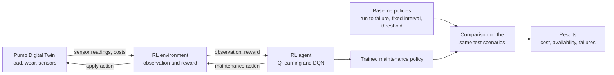

# Predictive Maintenance of a Pump with a Digital Twin and Reinforcement Learning

Course project for **Work Systems Design** (IIT Kharagpur, Autumn 2026-27).

A centrifugal pump in a thermal power plant wears out as it runs. This project builds a **Digital Twin** of the pump in Python: a simulation that wears out over time, gives noisy sensor readings and responds to maintenance actions. A **Reinforcement Learning agent** interacts with the twin and learns when to keep running, when to do minor maintenance and when to do a major overhaul. The agent is compared with the classic maintenance strategies (run to failure, fixed interval and condition based) on the same simulated scenarios.

## Project status

| Phase | Topic | Status |
|---|---|---|
| 0 | Problem statement and repository setup | Done |
| 1 | Domain study and data source decision | Done |
| 2 | Digital Twin | Done |
| 3 | Twin verification and EDA | Not started |
| 4 | RL environment | Not started |
| 5 | Baselines and evaluation harness | Not started |
| 6 | Tabular Q-learning with value iteration check | Not started |
| 7 | DQN agent in PyTorch | Not started |
| 8 | Maintenance decision support | Not started |
| 9 | Final evaluation | Not started |
| 10 | Final documentation | Not started |

## Workflow

This diagram shows the **planned** design. It will be updated as each phase is built and tested.



## Repository structure (current)

```
.
├── README.md
├── requirements.txt      pinned library versions
├── pytest.ini            test settings
├── src/
│   ├── config.py         paths, seed ranges and all Digital Twin constants
│   └── pump_twin.py      the pump Digital Twin (load, wear, sensors, maintenance)
└── tests/
    ├── test_setup.py     checks that the environment works
    └── test_twin.py      checks the Digital Twin
```

## The Digital Twin

The twin simulates one motor driven boiler feed pump in a coal fired power plant, one week per step.

- **Load:** weekly unit load (60%, 75% or 90% of rated flow) changes as a Markov chain.
- **Hidden wear:** bearing wear grows faster as the bearing gets worse; impeller and wear ring wear grows steadily. Both grow with load². The shapes follow the NASA centrifugal pump prognostics model.
- **Sensors:** vibration (mm/s RMS), bearing temperature (°C) and efficiency, each with noise. Vibration warns first and temperature rises only near the end, as in practice.
- **Maintenance:** minor maintenance renews the bearing; a major overhaul renews bearing and impeller; a failed pump must be repaired.
- **Limits:** vibration zones from ISO 10816-7 (Category I, above 200 kW) and bearing temperature limits from a power plant pump specification.

More folders (`scripts/`, `notebooks/`, `models/`, `results/`) are added in the phases that need them.

## Setup

Requires Python 3.12. The virtual environment is kept outside the project folder.

```bash
python3 -m venv ~/venvs/pump-rl
source ~/venvs/pump-rl/bin/activate
python -m pip install --upgrade pip
cd path/to/this/repository
pip install -r requirements.txt
python -m pytest
```

All tests should pass. Tested on macOS (Apple silicon, Python 3.12.2) and Linux (Python 3.12.3).

## Author

Nishank Chandoliya, IIT Kharagpur
